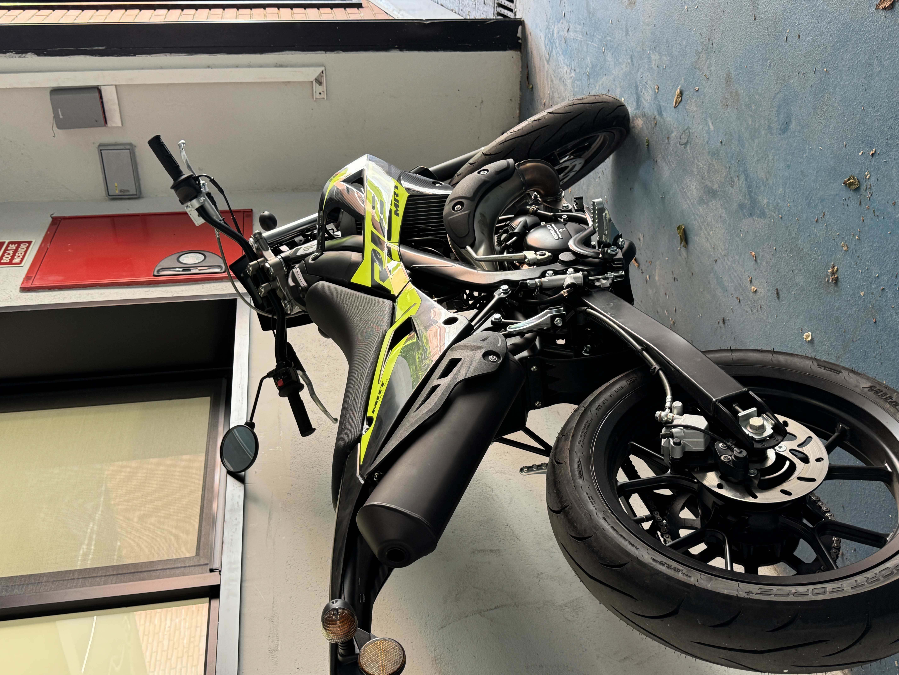

# Por qué voy en moto al instituto

## Introducción

Ir en **moto** al instituto me ahorra tiempo cada día. Es un transporte *rápido* y práctico, y el ahorro se puede calcular con una simple resta en `python`.

## Cálculo del tiempo

```python
tiempo_coche = 20
tiempo_moto = 10
ahorro = tiempo_coche - tiempo_moto
print(ahorro)  # 10 minutos
```

## Ventajas de la moto

- Se aparca fácilmente
- Se esquivan los atascos
- Gasta poco combustible

## Mi rutina por la mañana

1. Me pongo el casco
2. Arranco la moto
3. Llego al instituto 10 minutos antes

## Enlaces

- Enlace externo: [DGT](https://www.dgt.es)
- Enlace interno: [Más detalles](docs/detalles.md)

## Imágenes

Mi moto:



Mi instituto (Wikimedia Commons):


## Comparación moto y coche

| Transporte | Tiempo hasta el instituto | Ventaja |
|------------|---------------------------|---------|
| Moto       | 10 minutos                | Ahorro de 10 minutos |
| Coche      | 20 minutos                | Más comodidad con lluvia |
